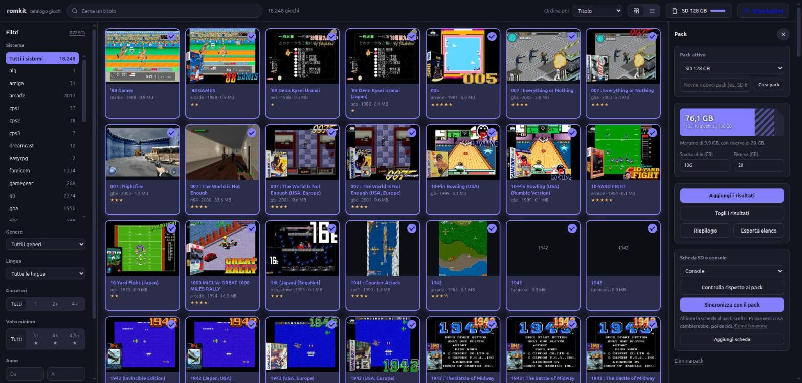

# romkit (working name)

Web catalogue and «pack» management for SD cards of ArkOS/EmulationStation handhelds (R36S and similar).

It works on **your own** ROM collection (one folder per system, with `gamelist.xml` and images). It ships and downloads no ROMs.



## Features
- **Catalogue**: search, filters (system, language, genre, year, rating, players), grid or list view, details.
- **Packs**: pick games for an SD card (e.g. 128 GB); size is computed and reduced gamelists, a copy list and a report are produced.
- **Copy**: `rsync` to the card (dry-run by default).
- **Play** (optional, off by default): in-browser play with EmulatorJS, trusted LAN only.

## Quick start (no ROMs, fake collection)
```
pip install -e .
romkit serve      # open http://127.0.0.1:8765/ and choose "Try a demo"
```

## With your collection
The web interface (catalogue, packs, sync and guided setup) comes in **Italian and English**: the language follows the browser and can be changed from the selector at the top. Terminal messages stay in Italian.

1. Run `romkit serve` with no `config.toml`: a **guided setup** opens in the browser (collection, work folders, cards, network access, "Gioca") and builds the catalog at the end. Reopen it with the "Impostazioni" button or `romkit serve --setup`. By hand instead: `cp config.example.toml config.toml`, set `[archivio].percorso`, run `romkit catalogo`, then `romkit serve`.
3. Create a pack in the web page, then `romkit pack prepara "Pack name" FOLDER` and read `report.txt`.
4. `romkit pack copia FOLDER` (dry-run), then add `--applica`.

## Syncing a card with a pack
In the "Pack" panel pick the pack and the card (mounted on this PC), then press **Sincronizza con il pack**.
1. **Preview**: shows how many games would be added, updated or removed. Nothing is written. Progress is shown step by step.
2. **Choose**: exclude whole systems, or do only additions or only removals.
3. **Apply**: asks for a second confirmation, then copies (with speed and time left) and moves files.
4. **Check**: sync again; it should report the card as aligned.

Removed games are moved to `_rimossi/<date>/` on the card, never deleted; saves, settings, `ports` and support files are left alone; removing more than 20% of the card needs an extra confirmation. Writes are only allowed from the PC running the program (over the LAN the catalog is read-only). Cards must be mounted locally for now.

## Security
The server listens on `127.0.0.1` only by default and has no authentication. Never expose it to the Internet. «Play» serves ROMs: keep it off outside a trusted home network.

Requires Python ≥ 3.11, Pillow, `rsync`. Linux/macOS for now. MIT licence.
