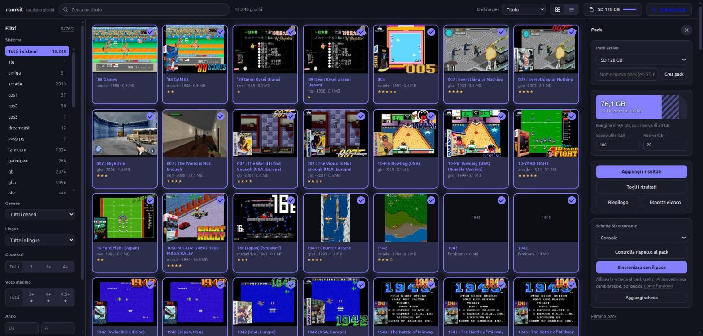

# romkit (nome di lavoro)

Catalogo web e gestione di «pack» per le schede SD di console portatili con ArkOS/EmulationStation (R36S e simili).

*English version: [README.en.md](README.en.md)*

Il programma lavora sul **tuo** archivio di ROM (una cartella per sistema, con `gamelist.xml` e immagini).
Non include ROM, né le scarica.



## Cosa fa
- **Catalogo**: pagina web con ricerca, filtri (sistema, lingua, genere, anno, voto, giocatori), vista a griglia o lista, dettaglio.
- **Pack**: scegli dal catalogo i giochi per una SD (es. 128 GB); il programma calcola lo spazio e crea gamelist ridotti, elenco di copia e report.
- **Copia**: `rsync` verso la SD (dry-run di default).
- **Gioca** (opzionale, spento): prova i giochi nel browser con EmulatorJS, solo in rete fidata.

## Avvio rapido (senza ROM, con archivio di prova)
```
pip install -e .
romkit demo prova
romkit --config prova/config.toml catalogo
romkit --config prova/config.toml serve      # http://127.0.0.1:8765/index.html
```

## Con il tuo archivio
1. `romkit serve` senza `config.toml`: si apre la **configurazione guidata** nel browser (archivio, cartelle di lavoro, schede, accesso dalla rete, «Gioca») e al termine costruisce il catalogo. La si riapre con il pulsante «Impostazioni» o con `romkit serve --setup`. In alternativa si può fare a mano: `cp config.example.toml config.toml`, imposta `[archivio].percorso` e lancia `romkit catalogo`.
2. `romkit serve` e apri il catalogo; crea un pack e seleziona i giochi.
3. `romkit pack prepara "Nome pack" CARTELLA` e controlla `report.txt`.
4. `romkit pack copia CARTELLA` (prova) poi `romkit pack copia CARTELLA --applica`.

## Sincronizzare una scheda con un pack
Nel pannello «Pack», scegli il pack e la scheda (inserita in questo PC) e premi **Sincronizza con il pack**.
1. **Anteprima**: il programma confronta scheda e pack e mostra quanti giochi sarebbero aggiunti, aggiornati o tolti. Non scrive nulla. Il calcolo può richiedere qualche minuto e mostra l'avanzamento passo per passo.
2. **Scelta**: puoi escludere interi sistemi, oppure fare solo le aggiunte o solo le rimozioni.
3. **Applicazione**: «Applica le modifiche» chiede una seconda conferma, poi copia (con velocità e tempo residuo) e sposta.
4. **Controllo**: rifai la sincronizzazione; deve dire che la scheda è allineata.

Garanzie: i giochi tolti vengono spostati in `_rimossi/<data>/` sulla scheda, mai cancellati; salvataggi, impostazioni, `ports` e file di servizio non si toccano; se le rimozioni superano il 20% della scheda serve una conferma in più; un registro `sync-<data>.log` resta nella cartella del pack. I sistemi esclusi dalla sincronizzazione si impostano in `[sync].non_toccare` (default `["ports"]`).
Le modifiche sono possibili solo dal PC che ospita il programma: aprendolo dalla rete locale (`host = "0.0.0.0"`) il catalogo è solo consultabile. Per ora le schede devono essere montate localmente.

## Sicurezza
Il server ascolta di default solo su `127.0.0.1` e non ha autenticazione. Non esporlo su Internet.
«Gioca» serve le ROM: tienilo spento salvo che in rete domestica.

## Requisiti
Python ≥ 3.11, Pillow, `rsync` (per la copia). Per ora Linux/macOS.

Licenza MIT.
